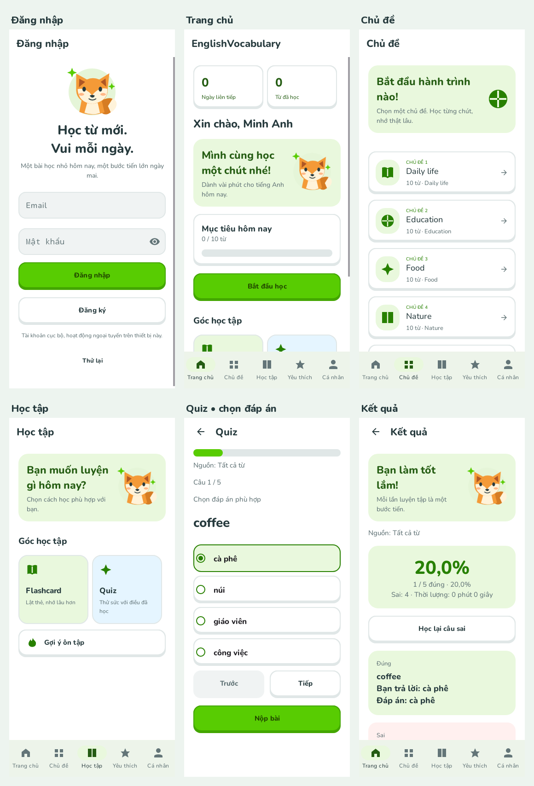

# EnglishVocabulary

Ứng dụng Android Java, Room và MVVM triển khai theo `SRS_Android_Hoc_Tu_Vung_v1.docx` (14/10/2026). Tài khoản và dữ liệu hoạt động cục bộ, không cần Internet khi sử dụng ứng dụng.

## Giao diện



[Xem toàn bộ ảnh giao diện, chế độ tối và chữ lớn](docs/design/README.md).

## Chạy ứng dụng

Mở project bằng Android Studio, dùng **JDK 25**, Android SDK **37.0** và Gradle wrapper **9.6.0**, rồi chạy cấu hình `app` trên thiết bị Android API 24 trở lên.

```bash
bash gradlew :app:assembleDebug
bash gradlew :app:testDebugUnitTest :app:lintDebug
```

Trong môi trường cloud đã chuẩn bị:

```bash
cd /workspace/EnglishVocabulary
source /workspace/.onboarding/android-env.sh
bash gradlew :app:assembleDebug :app:testDebugUnitTest :app:lintDebug --no-daemon --max-workers=2
```

APK: `app/build/outputs/apk/debug/app-debug.apk`.

Đăng ký tài khoản ngay trên thiết bị rồi đăng nhập; không có tài khoản hoặc mật khẩu demo được cài sẵn. Khi kho từ trống, ứng dụng tạo 60 từ thuộc 6 chủ đề trong một giao dịch. Nếu đã có từ, ứng dụng giữ nguyên kho hiện tại. Những trường tùy chọn chưa có dữ liệu hiển thị “Chưa có thông tin”.

## Các luồng đã triển khai

- Đăng ký, đăng nhập, khóa thử sai, đổi mật khẩu, sửa tên và đăng xuất.
- Home, tiến độ ngày, chủ đề, tìm kiếm Anh/Việt, chi tiết, trạng thái học và dấu sao theo tài khoản.
- Flashcard, ba dạng Quiz, chấm và lưu kết quả, học lại câu sai, tiếp tục phiên dở và snapshot lịch sử.
- Danh sách tự tạo, đổi tên, thêm/bỏ thành viên và xóa danh sách có xác nhận.
- Lịch sử có bộ lọc, streak, huy hiệu, thống kê, giao diện sáng/tối/hệ thống, Việt/Anh, mục tiêu, nhắc học và đặt lại dữ liệu.

Chi tiết truy vết và các kiểm tra còn cần thiết: [docs/SRS_IMPLEMENTATION.md](docs/SRS_IMPLEMENTATION.md).

## Kiến trúc và dữ liệu

`MainActivity` quan sát `AppViewModel`; ViewModel gọi `AppRepository`; repository chạy tác vụ Room trên một executor. `LearningRules` chứa quy tắc thuần Java có unit test. Các ghi nhiều bản ghi sử dụng transaction; mỗi session/item có khóa chống nộp hoặc đánh giá trùng. View không truy cập DAO.

Database phiên bản 2 dùng migration cộng thêm từ phiên bản 1, không destructive migration. Các bảng cũ và nội dung từ vựng được giữ; lịch sử/dấu sao cũ không có chủ tài khoản được giữ trong bảng cũ và không tự gán cho tài khoản mới. Dấu sao và trạng thái của ứng dụng mới nằm trong `user_words`.

Mật khẩu được dẫn xuất bằng PBKDF2, salt ngẫu nhiên riêng 16 byte, hash 32 byte, 210.000 vòng; thuật toán và số vòng lưu cùng tài khoản. API 24/25 dùng PBKDF2-HMAC-SHA1 nếu provider chưa hỗ trợ SHA256; các API hỗ trợ dùng SHA256. Không lưu mật khẩu rõ hoặc mật khẩu vào SavedStateHandle. Database và thông tin phiên bị loại khỏi cả backup và device transfer.

## Kiểm thử

Test thuần Java và Robolectric kiểm tra quy tắc Quiz, Unicode, ranh giới mật khẩu/tên, streak, thống kê, Room migration, cách ly tài khoản, checkpoint, nộp trùng, đặt lại dữ liệu, điều khiển Flashcard, xoay Activity và lịch nhắc. Robolectric sử dụng kho Maven Central và thư mục cache test có quyền ghi.

Báo cáo tự động nằm ở `app/build/reports/tests/testDebugUnitTest/` và `app/build/reports/lint-results-debug.html`.

Cloud hiện chưa có emulator hoặc thiết bị kết nối. Kiểm thử instrumentation, API 24/33/37 trên thiết bị, thông báo sau reboot thật, TalkBack, font 130%, và benchmark theo NFR chưa được xác nhận. Chạy `bash gradlew :app:connectedDebugAndroidTest` khi có thiết bị; không xem unit test là thay thế nghiệm thu 39 FR trên thiết bị.
