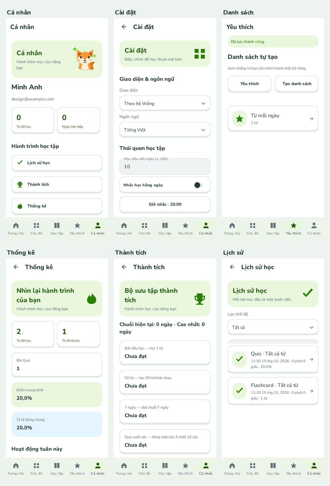
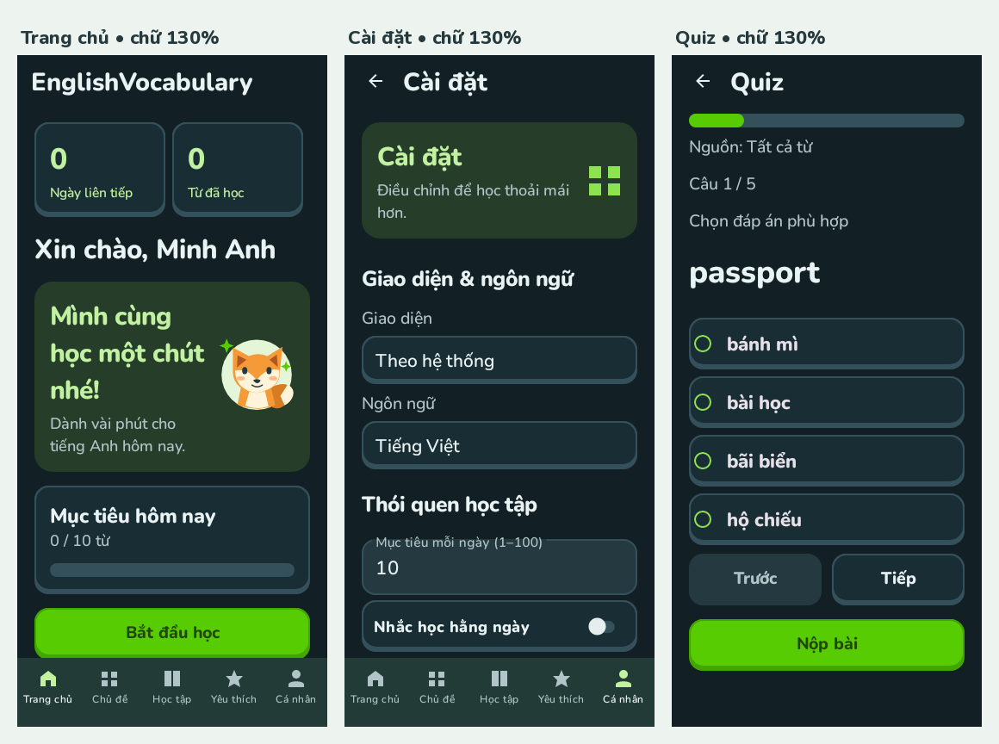

# Giao diện mới

Thiết kế vui tươi với xanh lá, font bo tròn Nunito, nút có chiều sâu, thẻ nội dung rõ ràng và một nhân vật cáo riêng. Ảnh dưới đây được render từ **Android View thực tế bằng Robolectric native graphics**, trên bố cục rộng 360dp; không phải bản mockup HTML. Tài khoản và dữ liệu trong ảnh được tạo riêng cho kiểm thử.

## Các màn hình chính


## Cá nhân, cài đặt và tiến độ



## Chế độ tối và chữ 130%



## Xem từng màn hình

| Nhóm | Ảnh |
| --- | --- |
| Tài khoản | [Đăng nhập](screens/01-login.png), [Đăng ký](screens/02-register.png), [Sửa hồ sơ](screens/edit_profile.png), [Đổi mật khẩu](screens/password.png) |
| Home và khám phá | [Trang chủ](screens/03-home.png), [Chủ đề](screens/topics.png), [Danh sách từ](screens/words.png), [Chi tiết từ](screens/detail.png) |
| Học tập | [Chọn cách học](screens/learning.png), [Chọn nguồn](screens/source-picker.png), [Cấu hình Quiz](screens/quiz-config.png), [Flashcard](screens/flashcard.png), [Mặt sau](screens/flashcard-back.png), [Quiz](screens/quiz-selected.png), [Kết quả](screens/quiz-result.png) |
| Danh sách | [Yêu thích/danh sách](screens/favorites-populated.png), [Tạo danh sách](screens/collection_form.png), [Quản lý thành viên](screens/collection-members.png) |
| Tiến độ và hệ thống | [Lịch sử](screens/history-populated.png), [Thành tích](screens/achievements.png), [Thống kê](screens/stats-populated.png), [Cài đặt](screens/settings.png), [Thông tin](screens/about.png) |

Các màn hình dài có thể cuộn; ảnh thể hiện vùng nhìn đầu tiên. Ảnh render không thay thế kiểm thử trên thiết bị thật, TalkBack hoặc kiểm tra bàn phím hệ thống.

## Tái tạo ảnh

```bash
bash gradlew :app:testDebugUnitTest --tests '*DesignRenderTest'
```

Ảnh được ghi vào `app/build/design-renders/`. Hai test bao phủ các nhóm màn hình, chế độ tối và thay đổi cấu hình font 130%. Nghiệp vụ, dữ liệu Room và các kiểm thử trước đó được giữ lại.

Font Nunito lấy từ Google Fonts, tạo hai instance tĩnh (500/800) để dùng trên API 24 trở lên. [Giấy phép SIL OFL 1.1](Nunito-OFL.txt) được giữ trong mã nguồn và đóng gói tại `assets/licenses/Nunito-OFL.txt`. Nhân vật cáo và các vector minh họa được vẽ riêng cho giao diện này.
